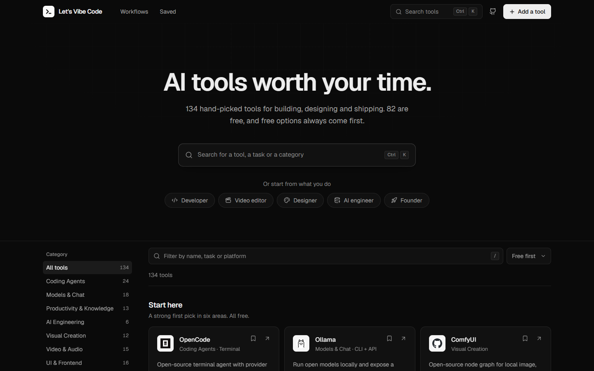
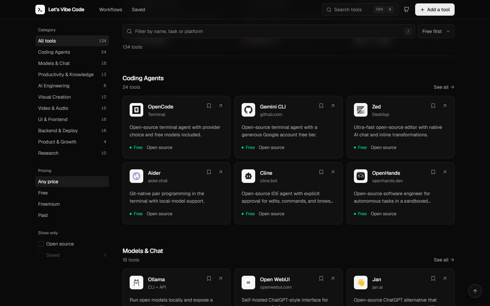
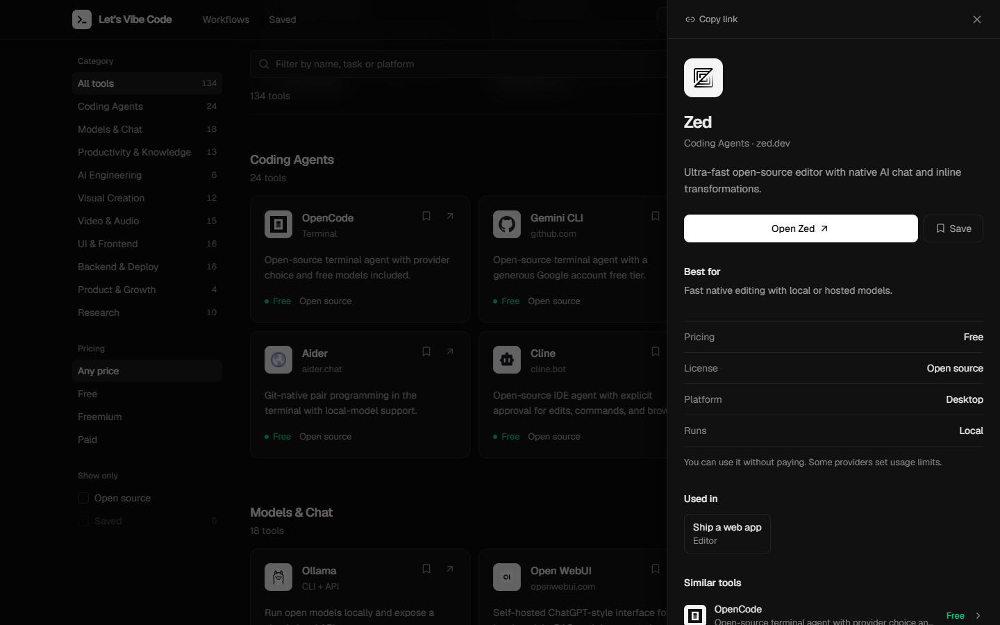

<div align="center">


# Let's Vibe Code

**A hand-picked directory of AI and developer tools, with free and open-source options listed first.**

[Live site](https://lets-vibe-code-v-2.vercel.app/) · [GitHub Pages mirror](https://mkjaswanth.github.io/LetsVibeCode.v.2/) · [Suggest a tool](https://github.com/MKJaswanth/LetsVibeCode.v.2/issues/new?title=Add%20tool%3A%20)

</div>



## Why it exists

Most AI tool directories list thousands of entries, rank them by paid placement and leave you to work out which ones are free. Let's Vibe Code keeps the list short and checked by hand. Each tool says what it costs, whether it's open source and what it's good for. Free tools always come first.

## Features

- **134 tools in 10 categories**, from coding agents and local model runners to video, design, backend and research tools.
- **Search from anywhere.** Press `Ctrl K` (or `⌘ K` on a Mac) to jump to any tool, category, role or workflow. Press `/` to filter the list in place.
- **Filters that combine.** Filter by category, pricing, open source and saved tools at the same time. Category counts update to match the other filters, and each active filter shows as a chip you can remove.
- **Start from your role.** Developers, video editors, designers, AI engineers and founders each get four starter tools and a filtered list.
- **Workflows.** Six sets of four tools that cover a whole job, such as *Ship a web app* or *Make a video*, with what each tool is used for.
- **A detail panel for every tool**, with pricing, license and platform, the workflows the tool appears in, and similar tools.
- **Shareable links.** `?tool=ollama` opens a tool and `?role=designer` opens a role.
- **No account needed.** Saved tools and tools you add stay in your browser.
- **Works with the keyboard and screen readers.** Panels keep focus inside while open and close with `Esc`. Every control is a real button or link, and reduced-motion settings are respected.

<table>
  <tr>
    <td></td>
    <td></td>
  </tr>
</table>

## What's in the catalog

| Category | Tools |
| --- | ---: |
| Coding Agents | 24 |
| Models & Chat | 18 |
| UI & Frontend | 16 |
| Backend & Deploy | 16 |
| Video & Audio | 15 |
| Productivity & Knowledge | 13 |
| Visual Creation | 12 |
| Research | 10 |
| AI Engineering | 6 |
| Product & Growth | 4 |

Paid tools stay in the list only when they still lead their category. The catalog was last reviewed in November 2026.

## Tech stack

| | |
| --- | --- |
| Framework | [React 18](https://react.dev) |
| Build tool | [Vite 5](https://vitejs.dev) |
| Styling | [Tailwind CSS 4](https://tailwindcss.com) |
| Motion | [Framer Motion](https://motion.dev) |
| Icons | [Lucide](https://lucide.dev) |
| Font | [Geist](https://vercel.com/font) |

There is no backend. The catalog is a JavaScript module that ships with the app.

## Getting started

You need [Node.js](https://nodejs.org) 20 or newer.

```bash
git clone https://github.com/MKJaswanth/LetsVibeCode.v.2.git
cd LetsVibeCode.v.2
npm install
npm run dev
```

The app runs at http://localhost:5173.

| Command | What it does |
| --- | --- |
| `npm run dev` | Starts the dev server with hot reload |
| `npm run build` | Builds the production bundle into `dist/` |
| `npm run preview` | Serves the production build locally |
| `npm run lint` | Runs ESLint |

## Project structure

```
src/
├── App.jsx                 # Page layout, filter state, URL sync, keyboard shortcuts
├── components/
│   ├── Header.jsx          # Top bar, logo, search trigger
│   ├── Hero.jsx            # Headline, search box, role buttons
│   ├── FilterPanel.jsx     # Category, pricing and "show only" filters
│   ├── Toolbar.jsx         # Sticky filter input, sort, active filter chips
│   ├── ToolCard.jsx        # A tool in the grid
│   ├── ToolPanel.jsx       # Slide-in detail panel
│   ├── CommandPalette.jsx  # Ctrl/⌘ K search
│   ├── Workflows.jsx       # Workflow cards on the home page
│   ├── Banners.jsx         # Role and workflow summaries above results
│   ├── MobileFilters.jsx   # Filter sheet for small screens
│   └── SubmitModal.jsx     # "Add a tool" form
├── data/
│   ├── tools.js            # The catalog
│   ├── roles.js            # Roles and their starter tools
│   └── workflows.js        # Workflows and the job each tool does
└── lib/
    ├── catalog.js          # Search, filtering, sorting, similar tools
    ├── useDialog.js        # Focus trapping, Esc to close, scroll lock
    └── useCopy.js          # Copy-to-clipboard state
```

## Adding or updating a tool

Every tool is one line in [`src/data/tools.js`](src/data/tools.js):

```js
tool('Ollama', 'Run open models locally and expose a simple local API.', 'https://ollama.com',
  'Models & Chat', 'free', { openSource: true, popular: true, featured: true }),
```

| Argument / option | Meaning |
| --- | --- |
| `name` | Display name. It must be unique, because it's also used for the `?tool=` link. |
| `desc` | One plain sentence about what the tool does. |
| `url` | The tool's website. The icon is taken from this domain. |
| `category` | One of the existing categories. |
| `pricing` | `'free'`, `'freemium'` or `'paid'`, based on how most people start using it. |
| `openSource` | `true` if the source code is public under an open license. |
| `popular` | Ranks the tool higher among tools with the same pricing. |
| `featured` | Can appear in *Start here* and in the command palette before you type. |
| `roles` | Optional list of role ids. Defaults are set per category. |

Optional `surface`, `execution` and `bestFor` details go in the `practicalMetadata` object in the same file. They show up in the detail panel.

To change a role's starter tools, edit [`src/data/roles.js`](src/data/roles.js). To change workflows, edit [`src/data/workflows.js`](src/data/workflows.js). Tool names in both files must match the catalog exactly.

## Deployment

- **Vercel** builds and deploys every push to `main` to https://lets-vibe-code-v-2.vercel.app.
- **GitHub Pages** is deployed by [`.github/workflows/deploy.yml`](.github/workflows/deploy.yml) on every push to `main`.

`vite.config.js` sets `base: './'` so the same build works at the domain root (Vercel) and under a sub-path (GitHub Pages). `.npmrc` sets `legacy-peer-deps` so installs on Vercel don't fail on peer dependency conflicts.

## Contributing

Suggestions and fixes are welcome.

- **Suggest a tool or report a wrong price or link:** [open an issue](https://github.com/MKJaswanth/LetsVibeCode.v.2/issues/new). The site's *Add a tool* form can pre-fill one for you.
- **Send a change:** fork the repo, create a branch, then run `npm run lint` and `npm run build` before opening a pull request.

When suggesting a tool, include what it does, what it costs to start and why it belongs on a short list.
